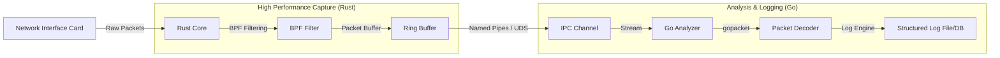

# ApexSniffer Architecture

ApexSniffer is a high-performance network sniffing and logging system designed to capture raw network traffic using a Rust-based core and analyze/log that traffic using a Go-based analyzer. 

## 1. System Diagram

## 2. Rust-Core Responsibilities

The Rust core is designed for maximum efficiency and minimum packet drop. It operates as the "Producer" in the system.

- **Packet Capture:** Utilizing `libpcap` or `af_packet` (Linux) / `npcap` (Windows) to capture raw frames from the NIC.
- **BPF Filtering:** Applying Berkeley Packet Filters (BPF) at the kernel level to ensure only relevant traffic reaches user space, reducing CPU overhead.
- **Zero-Copy Buffering:** Implementing a high-speed internal buffer to handle traffic spikes without losing packets.
- **IPC Transmission:** Streaming the raw bytes of captured packets through a high-throughput IPC mechanism (Named Pipes on Windows, Unix Domain Sockets on Linux) to the Go process.

## 3. Go-Analyzer Responsibilities

The Go analyzer acts as the "Consumer," focusing on data processing, protocol analysis, and persistence.

- **IPC Consumption:** Reading the raw byte stream from the Named Pipe/UDS.
- **Packet Decoding:** Using `gopacket` to decode the raw bytes into structured network layers (Ethernet, IP, TCP/UDP, Application layer).
- **Analysis:** Applying business logic to the decoded packets (e.g., flow tracking, anomaly detection).
- **Logging:** Writing the analyzed data to a structured log format (JSON, Parquet) or a database for long-term storage.

## 4. Data Flow: NIC to Log

1. **Ingress:** The NIC receives a frame; the kernel applies the **BPF filter**.
2. **Capture:** The **Rust Core** reads the filtered frame from the kernel buffer.
3. **Transport:** The Rust Core wraps the frame in the **Apex Packet Format** and writes it to the **Named Pipe/UDS**.
4. **Reception:** The **Go Analyzer** reads the packet from the pipe.
5. **Decoding:** `gopacket` parses the raw bytes into a usable Go structure.
6. **Persistence:** The analyzed packet details are written to the **Log**.

## 5. Packet Format (Wire Protocol)

To ensure efficient communication across the IPC channel, a simple binary framing protocol is used to avoid the overhead of heavy serialization (like JSON or Protobuf) for every packet.

### Frame Structure (Binary)

| Offset | Field | Size | Type | Description |
| :--- | :--- | :--- | :--- | :--- |
| 0 | `Magic` | 2 Bytes | `u16` | Constant `0x4150` ('AP') to identify start of frame |
| 2 | `Timestamp` | 8 Bytes | `i64` | Nanoseconds since epoch |
| 10 | `Length` | 4 Bytes | `u32` | Length of the raw packet data (N) |
| 14 | `Payload` | N Bytes | `bytes` | The raw Ethernet frame |

**Total Header Size:** 14 bytes.

**Example Flow:**
`[0x41 0x50] [Timestamp: 8 bytes] [Length: 0x00000042] [Raw Packet Data: 66 bytes]`
